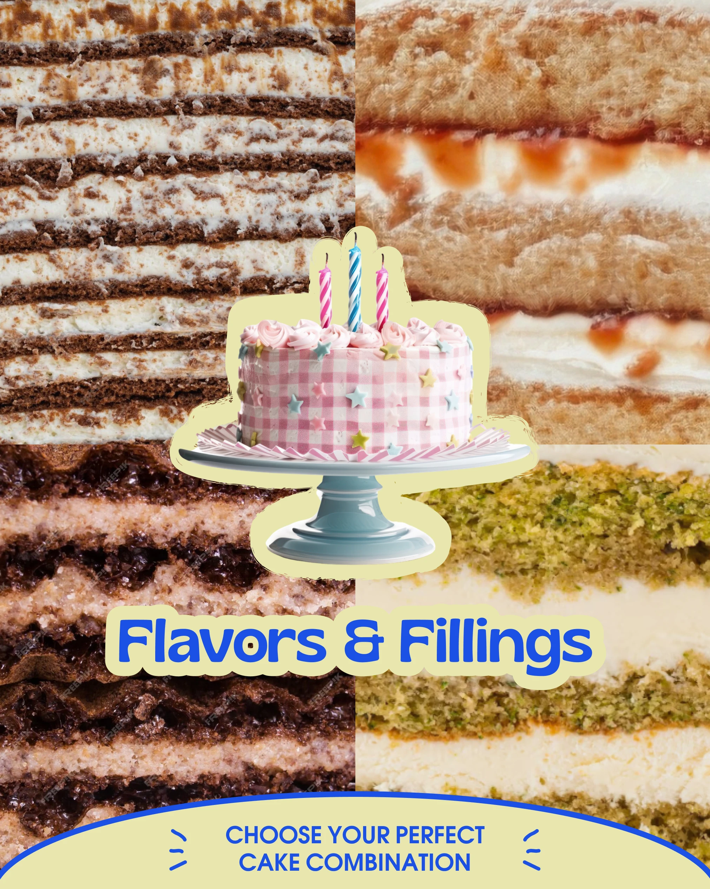

# Four macro cake cross-sections around a sticker cake with a cream arc footer

**Discipline:** print-social ·  · **Design style:** Playful & Illustrated
**Tags:** food, macro, collage, sticker-outline, cobalt, cream-arc, bubble-type, 4-up

## What it is
A 4:5 post with a 2x2 grid of close-up cake layer photos, a gingham cake on a stand cutout with a cream halo in the centre, a bold blue outlined title 'Flavors & Fillings', and a cream arc at the bottom holding a call to action.

## What it means
Mouth-watering and playful; macro layers create texture and the sticker cake is the anchor.

## Techniques
- Use macro layer photos as a textured backdrop.
- Overlay a sticker-outlined cutout at the centre.
- Set the title with a cream outline.
- End with a shallow arc footer.

## Best for
- Bakery menus and options posts
- Food texture showcases
- Sticker-collage layouts

## Vocabulary
- **Macro texture grid** — A grid of extreme close-ups.
- **Sticker cutout** — A cutout with a thick outline.
- **Outlined title** — Text with a contrasting stroke.
- **Arc footer** — A curved panel at the bottom.
