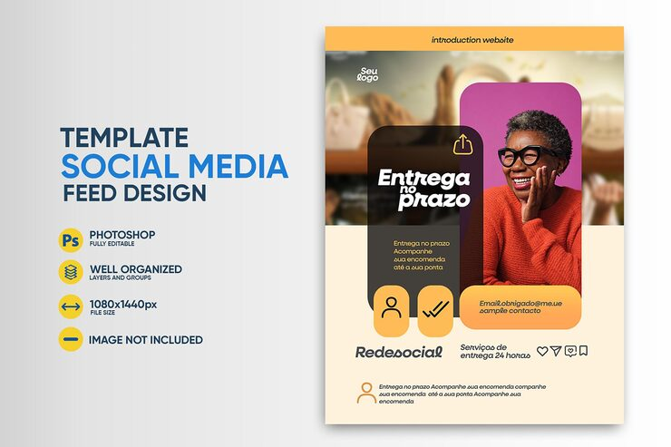

# Orange delivery service flyer with rounded photo panel

**Discipline:** print-social · **Design type:** Social promo post · **Design style:** Warm & Organic
**Tags:** flyer, delivery, orange, rounded panel, photo, service

## What it is
A delivery-service social flyer pairing a warm orange photo of a smiling customer with a large rounded dark panel overlapping the image, containing the offer copy and checkmark features.

## What it means
Letting a rounded content panel overlap directly onto the photo (rather than sitting beside it) merges photo and message into one continuous composition.

## Techniques
- overlap a large rounded content panel onto the edge of a photo rather than placing it beside it
- use a duotone-orange treatment on the photo so it harmonizes with a flat orange background
- pair checkmark icons with short benefit phrases for fast scannability

## Best for
- local delivery/service business promos
- small business social flyers
- warm-toned service marketing

## Vocabulary
- **content panel** — a distinct shaped area (often rounded or angled) used to hold text separately from a background image
