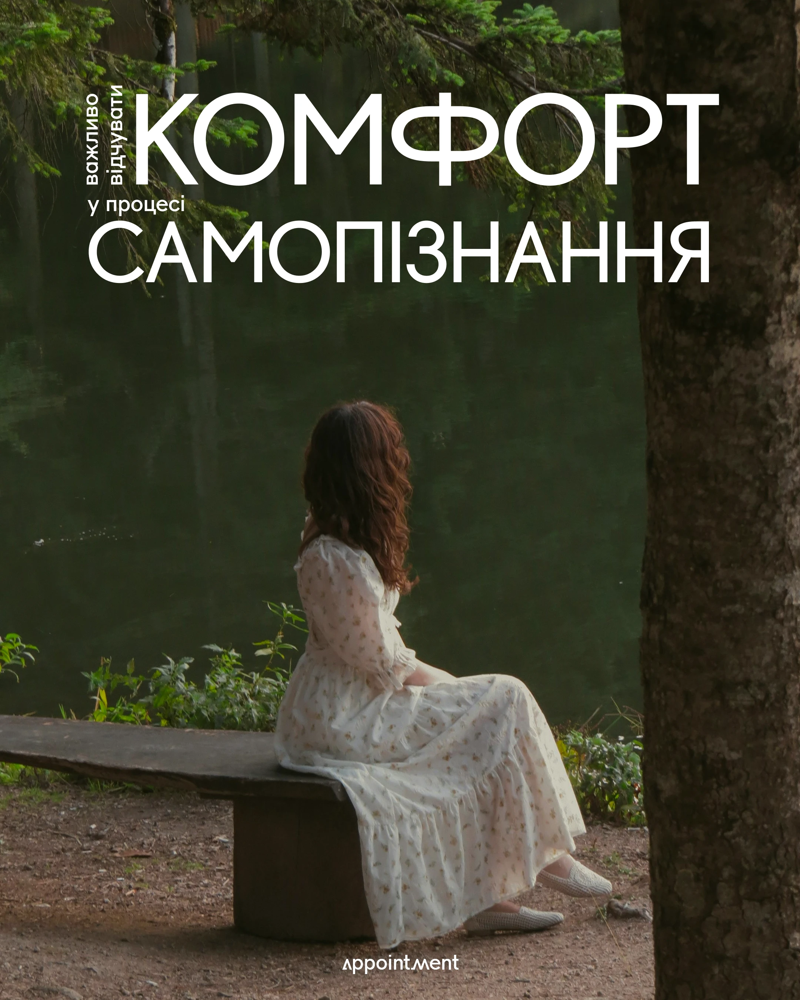

# Woman on a lakeside bench with giant white geometric caps and a small vertical caption

**Discipline:** print-social ·  · **Design style:** Geometric & Bauhaus
**Tags:** wellness, photo, forest, white-caps, geometric-sans, vertical-text, cyrillic, cover

## What it is
A green forest lake photo with a woman in a white floral dress seen from behind on a bench. Giant white geometric sans words 'КОМФОРТ САМОПІЗНАННЯ' fill the upper part with a small rotated caption at the left and a wordmark at the bottom.

## What it means
Serene and reflective; huge clean caps over quiet nature feel editorial.

## Techniques
- Place enormous geometric caps in the sky area of a photo.
- Rotate a small caption beside the giant word.
- Keep the palette from the photo (green, cream).
- Put a small wordmark centred at the base.

## Best for
- Therapy and wellness accounts
- Photo-led editorial covers
- Quiet carousel openers

## Vocabulary
- **Giant caps** — Very large uppercase words used as the main graphic.
- **Rotated caption** — Small vertical text next to a big word.
- **Photo-led cover** — A cover where the image sets the mood.
- **Geometric sans** — Sans letters built from circles and lines.
