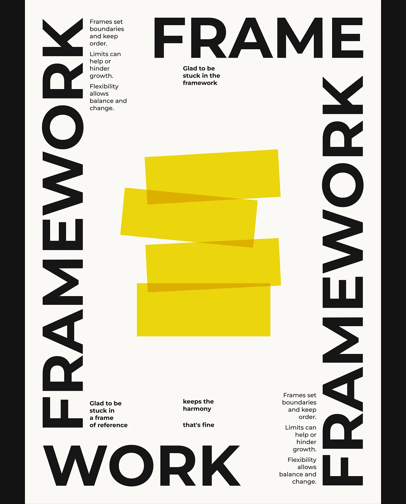

# Cream poster with rotated FRAMEWORK on both sides, FRAME and WORK across the edges, and four overlapping translucent yellow slabs

**Discipline:** print-social · **Design type:** Typographic posters
**Tags:** poster, yellow, black, cream, rotated-type, overlap, giant-type, concept

## What it is
A cream poster in a black frame with heavy black words framing the edges: 'FRAMEWORK' rotated up the left and right sides, 'FRAME' across the top right and 'WORK' across the bottom left, small columns of text beside them and four slightly rotated translucent yellow rectangles stacked in the middle that darken where they overlap.

## What it means
Structured and playful; type literally forms the frame while yellow slabs sit inside it.

## Techniques
- Frame the layout with giant words along its edges.
- Rotate words up both sides.
- Stack translucent rectangles that overlap to darker tones.
- Add tiny text columns.

## Best for
- Concept typographic posters
- Frame and border layouts
- Yellow and black graphics

## Vocabulary
- **Type frame** — Words forming a border around content.
- **Multiply overlap** — Translucent shapes darkening where they cross.
- **Rotated title** — A word turned 90 degrees.
- **Micro column** — A small block of text.
