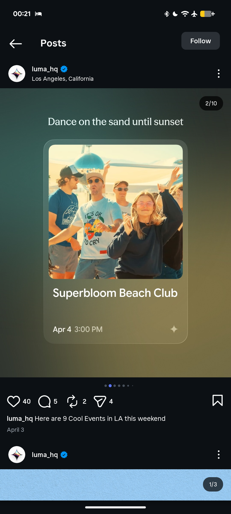

# Frosted Event Card over Olive-Teal Gradient

**Discipline:** print-social · **Design type:** Social carousel
**Tags:** event-card, frosted-glass, olive, teal, photo, serif, carousel, instagram

## What it is
An Instagram carousel slide on a blurred teal-to-olive gradient with a light serif line 'Dance on the sand until sunset', above a large frosted glass card holding a sunny beach-club photo, the event name in white, a date and time and a small sparkle icon.

## What it means
A translucent card floating on a colour wash reads like a mini app card, and the sunny photo pops against the moody gradient.

## Techniques
- Frosted card holding a photo and details
- Blurred gradient sampled from the photo
- Light serif headline above the card
- Date and time in two weights
- Sparkle icon as a brand mark

## Best for
- Event roundup carousels
- App-like promo cards
- Photo-in-glass layouts

## Vocabulary
- **Frosted card** — A translucent blurred card over a coloured backdrop.
- **Colour sampling** — Taking a background gradient from an image's colours.
- **Event card** — A card summarising an event with photo, title and time.
