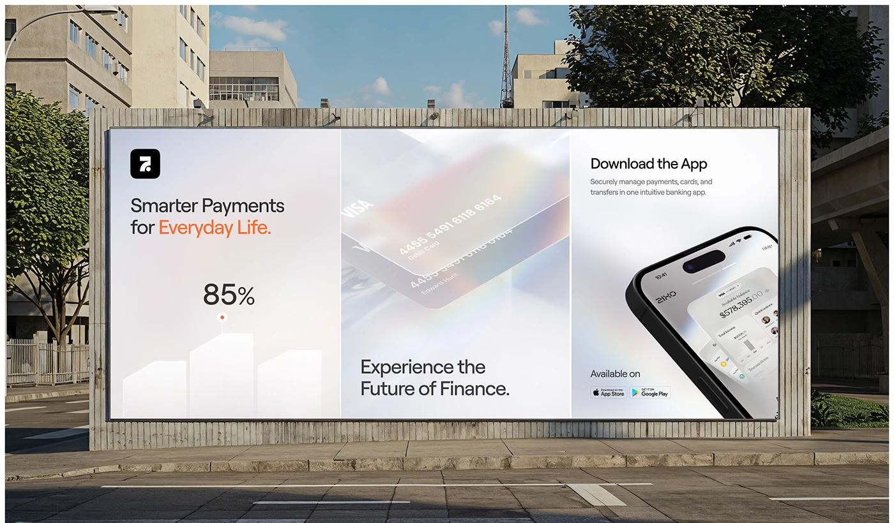

# Frosted Triptych Billboard on Concrete Hoarding

**Discipline:** print-social · **Design type:** Out-of-home poster set
**Tags:** billboard, triptych, frosted, white, orange, cards, phone, street

## What it is
A wide billboard on a slatted concrete hoarding split into three white frosted panels: a logo, 'Smarter Payments for Everyday Life.' with orange on the last words and a rising 85% bar graphic; a glass credit card in rainbow light with 'Experience the Future of Finance.'; and 'Download the App' with a tilted phone and store badges.

## What it means
Three soft panels with a single orange accent tell a complete story of promise, proof and action on one board.

## Techniques
- Three-panel story on one billboard
- Orange accent words as the only colour
- Frosted glass card image in the centre panel
- Angled phone cropped at the corner
- Store badges as the closing call to action

## Best for
- Fintech out-of-home advertising
- Triptych campaign layouts
- Soft glass-style ad boards

## Vocabulary
- **Triptych** — Three related panels shown side by side.
- **Hoarding** — A large outdoor billboard structure.
- **Call to action panel** — A panel dedicated to the download or next step.
