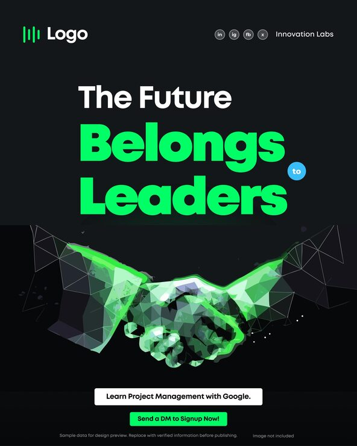

# 'The Future Belongs to Leaders' post with a glowing low-poly green handshake

**Discipline:** print-social · **Design type:** Social promo post · **Design style:** Dark & Neon
**Tags:** leadership, course, dark, neon-green, low-poly, handshake

## What it is
A portrait near-black post with a green bar logo, white 'The Future' over huge neon green 'Belongs Leaders' with a small blue 'to' circle, a wireframe low-poly handshake glowing green, and white and green button bars ('Learn Project Management with Google', 'Send a DM to Signup Now!').

## What it means
Techy and aspirational; the digital handshake symbolises partnership in a data-driven future.

## Techniques
- Render a symbol as glowing low-poly wireframe.
- Tuck a tiny connector word into a circle.
- Stack two contrasting CTA bars.
- Use one neon hue on near-black.

## Best for
- Online courses
- Leadership programmes
- Tech education promos

## Vocabulary
- **Low-poly** — 3D style built from visible flat triangles.
- **Wireframe** — An object drawn as its outline edges.
