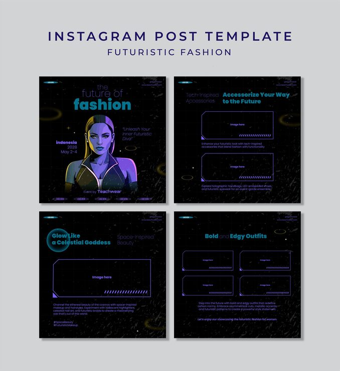

# 'The Future of Fashion' pack in black with neon purple-cyan cyber illustration and holographic accessories

**Discipline:** print-social · **Design type:** Social template pack · **Design style:** 3D & Surreal
**Tags:** fashion, futuristic, black, neon-purple, cyber-illustration, instagram

## What it is
Four black square posts with a glowing purple-cyan illustrated woman with a metallic zipper jacket, a starfield backdrop, thin corner frame lines, and headlines ('The Future of Fashion', 'Accessorize Your Way to the Future', 'Glow Like a Celestial Goddess', 'Bold and Edgy Outfits') with empty 'Image here' placeholder frames.

## What it means
Bold and otherworldly; neon-lit cyber illustration makes futuristic fashion feel like it belongs in a sci-fi universe.

## Techniques
- Illustrate a figure with neon rim lighting for a glowing effect.
- Use thin corner frame lines to suggest a HUD or interface.
- Leave labelled placeholder frames for swappable product photos.

## Best for
- Futuristic fashion campaigns
- Sci-fi themed branding
- Neon illustration templates

## Vocabulary
- **Rim lighting** — Light outlining a subject's edge, often used for a glowing effect.
- **HUD frame** — Thin corner lines suggesting a heads-up display interface.
