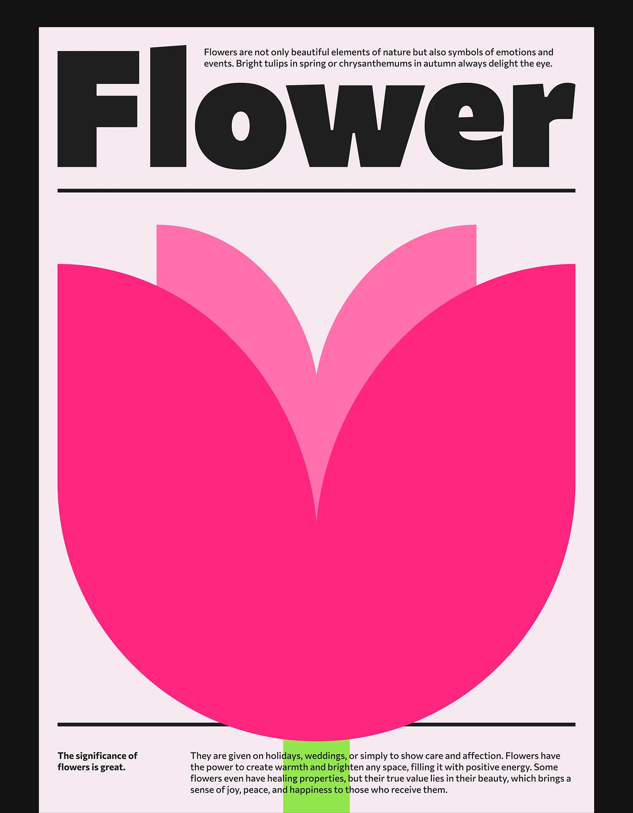

# Tulip built from two shapes in hot pink with giant black grotesque title

**Discipline:** print-social ·  · **Design style:** Geometric & Bauhaus
**Tags:** poster, geometric, flower, hot-pink, black-frame, heavy-type, swiss, minimal

## What it is
A pale pink poster in a black frame. A giant black 'Flower' fills the top, a rule sits beneath, then a huge tulip made of overlapping rounded pink shapes with a lime green stem crossing the text below. Small body copy sits in columns.

## What it means
Bold, playful and modernist; simple shapes say flower without any detail.

## Techniques
- Reduce a subject to two or three flat overlapping shapes.
- Set the title in an ultra-heavy face across the full width.
- Let the stem overlap body text for depth.
- Use hairline rules to organise the grid.

## Best for
- Poster series and posters with a single symbol
- Swiss-style graphics
- Bold editorial layouts

## Vocabulary
- **Shape reduction** — Simplifying an object into basic geometric forms.
- **Ultra-heavy type** — A very bold typeface weight.
- **Overlap layering** — Shapes placed over each other in different tints.
- **Hairline rule** — A thin line dividing sections.
