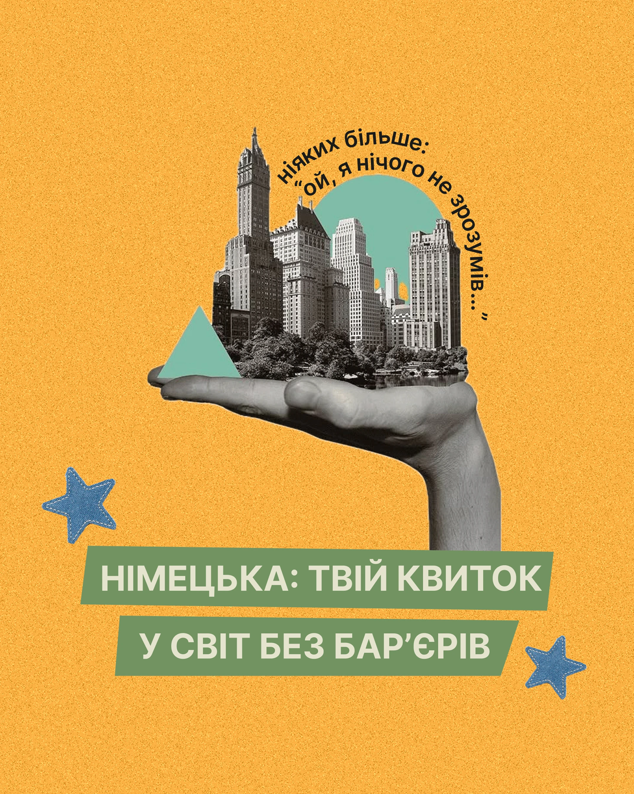

# Mustard post: greyscale hand holding a vintage skyline, teal arch, curved quote and green paper banners

**Discipline:** print-social ·  · **Design style:** Warm & Organic
**Tags:** collage, education, mustard, greyscale, teal, denim-stars, arched-text, paper-banner

## What it is
A grainy mustard 4:5 post with a black-and-white hand holding a cut-out old skyline and park, a teal arch and triangle behind, curved text along the arch, two blue denim star patches and two green torn-paper banners with cream caps.

## What it means
Surprising and hopeful; a city on a palm says 'your ticket to a world'.

## Techniques
- Set text along a curved path around the image.
- Use greyscale collage with two flat colour shapes.
- Put the title on torn green paper banners.
- Add stitched denim stars.

## Best for
- Language and education promotion
- Collage covers with a metaphor
- Curved-text layouts

## Vocabulary
- **Arched text** — Text following a curve.
- **Vintage collage** — Old photographs cut and combined.
- **Paper banner** — A ragged strip carrying a title.
- **Flat shape accent** — A simple geometric shape behind a photo.
