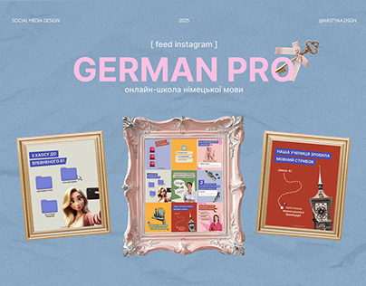

# Language-school feed displayed inside a pink baroque frame between two gold frames on dusty blue

**Discipline:** print-social ·  · **Design style:** Warm & Organic
**Tags:** feed-grid, frames, pink, blue-paper, serif-script, german, gallery, portfolio-cover

## What it is
A dusty blue crumpled-paper cover with a pink ribbon-bow title 'GERMAN PRO' in bold sans, and three ornate picture frames: pink baroque in the centre holding a 3x3 feed grid, and gold frames on either side holding single posts.

## What it means
Witty and gallery-like; framing posts as artworks lifts a feed to a museum.

## Techniques
- Present designs in ornate picture frames.
- Use crumpled paper as backdrop.
- Add a small bow and key as accents.
- Centre the largest frame with the feed grid.

## Best for
- Social-media portfolio covers
- Education and culture brands
- Gallery-style presentations

## Vocabulary
- **Frame mockup** — Designs shown inside picture frames.
- **Paper backdrop** — A crumpled paper texture.
- **Baroque frame** — An ornate decorative picture frame.
- **Feed-in-frame** — A full profile grid inside one frame.
