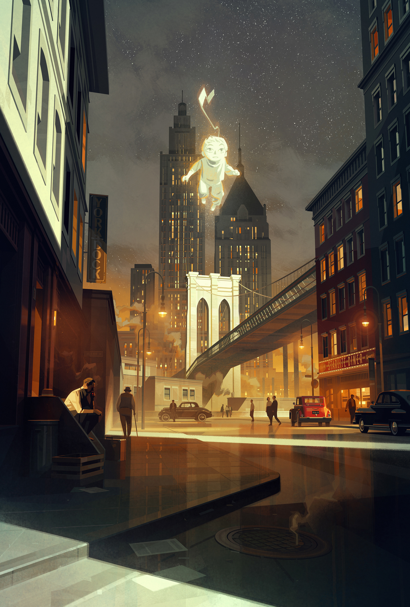

# Painterly 1940s New York street at dusk with a glowing ghost child floating above the bridge

**Discipline:** print-social · **Design type:** Editorial illustration · **Design style:** Photographic & Cinematic
**Tags:** illustration, new-york, noir, glow, vintage-cars, cinematic

## What it is
A tall digital painting of a 1940s city street: art-deco skyscrapers, a stone bridge tower, an elevated walkway, vintage cars, a 'Starlite Diner' sign, figures in hats, wet pavement reflections and a luminous ghostly child with a kite floating in the starry sky.

## What it means
Nostalgic and magical; warm streetlight and one glowing figure turn a realistic scene into a quiet fairytale.

## Techniques
- Make one element the only light-emitting subject.
- Use warm streetlight against cool night for depth.
- Frame the focal point with tall buildings as leading lines.
- Add small human figures for scale and story.

## Best for
- Book covers and posters
- Film key art
- Narrative illustration

## Vocabulary
- **Leading lines** — Lines in a composition that guide the eye to the subject.
- **Key light** — The main light source that defines the mood.
