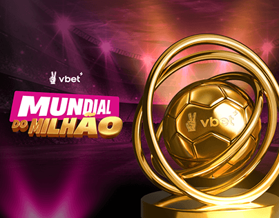

# Gold football trophy ringed by loops in a magenta stadium with a pink label title

**Discipline:** print-social · **Design type:** Event key visual
**Tags:** sports, campaign, gold, magenta, stadium, 3d-render, trophy, key-visual

## What it is
A magenta-lit stadium with beams of light and a large gold football wrapped by looping gold rings on a podium, with a pink skewed label 'MUNDIAL DO MILHÃO' and a small logo at the top left.

## What it means
Glamorous and thrilling; gold and magenta feel like a jackpot.

## Techniques
- Render a hero object wrapped in gold rings.
- Light the scene in magenta beams.
- Use a skewed pink label title.
- Place a small logo up top.

## Best for
- Sports and betting campaigns
- Prize and contest key visuals
- 3D gold objects

## Vocabulary
- **Gold render** — A glossy metallic gold 3D object.
- **Light beams** — Shafts of stage light in the scene.
- **Skewed label** — A tilted parallelogram title.
- **Prize visual** — An image centred on a trophy.
