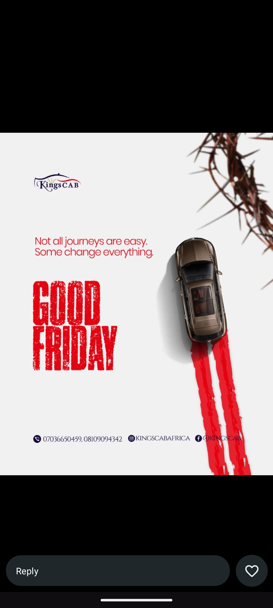

# Good Friday Ad with Red Tyre Tracks

**Discipline:** print-social · **Design type:** Social ad
**Tags:** holiday, good-friday, red, white, distressed-type, car, thorns, concept

## What it is
A square holiday ad for a cab brand on off-white: a crown of thorns at the top right, a car seen from above at the head of two red tyre tracks that run to the bottom edge, a red distressed condensed 'GOOD FRIDAY', a line 'Not all journeys are easy. Some change everything.', the logo and contact icons.

## What it means
Turning the tyre tracks into red paint or blood links the brand's journeys to the holiday's meaning with a single image and few words.

## Techniques
- Tyre tracks doubling as a red brush stroke
- Distressed condensed type for weight
- Overhead car shot on an empty ground
- Red as the only colour on white
- Symbolic prop (thorns) at the frame edge

## Best for
- Holiday and seasonal brand posts
- Concept ads that pair product and meaning
- Transport and service brands

## Vocabulary
- **Visual pun** — An image that reads two ways at once.
- **Distressed type** — Lettering with worn, rough edges.
- **Overhead shot** — An image taken from directly above the subject.
