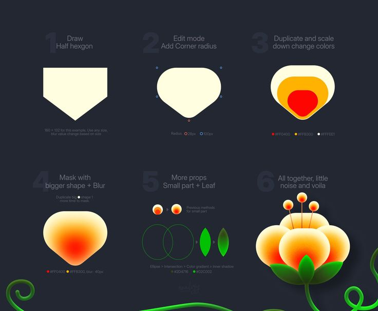

# Gradient Flower Illustration Tutorial

**Discipline:** print-social · **Design type:** Social educational post
**Tags:** tutorial, steps, gradient, flower, vector, dark, how-to

## What it is
A six-step tutorial on charcoal showing how a glowing orange-red flower is built: half hexagon, corner radius, nested scaled copies, masked blur, leaf shapes, and the finished flower with vines.

## What it means
Big faint step numbers and simple shapes make craft approachable. The glowing finished piece rewards the reader.

## Techniques
- Oversized ghost numerals as step markers
- Layout of six equal cells with progressive complexity
- Parameter labels (radius, colors, blur) under each step
- Finished result at full saturation as the payoff
- Vines framing the corners

## Best for
- Design tutorials and process posts
- Illustration and icon designers
- Educational carousels

## Vocabulary
- **Step numeral** — A large faded number marking each stage of a process.
- **Masked blur** — A blur limited to a shape to create soft glowing color.
- **Payoff frame** — The final polished result shown last and most vividly.
