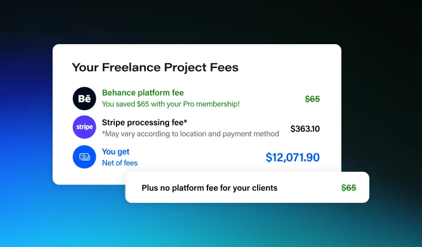

# Fee Breakdown Card on Blue Gradient

**Discipline:** print-social · **Design type:** Product UI promo card
**Tags:** gradient, ui-fragment, fintech, promo, pricing, stacked-cards

## What it is
A promo card with a white panel listing project fees with green savings and a blue net total, plus a smaller overlapping pill card reading 'Plus no platform fee for your clients', over a deep teal-to-blue gradient.

## What it means
Real numbers inside a real-looking widget make the offer credible. Color coding, green for savings and blue for what you get, lets the eye follow the money story in seconds.

## Techniques
- Use semantic color inside the UI: green for saved, blue for total, black for neutral
- Strike-through the fee to show a discount visually
- Add a secondary overlapping strip that delivers the punchline
- Bottom-weighted gradient that brightens toward the foot of the frame
- Large, rounded white cards that keep text legible against the vivid backdrop

## Best for
- Pricing or fee-related announcements
- Fintech and marketplace social posts
- Explaining a value proposition with concrete numbers

## Vocabulary
- **Punchline strip** — A small secondary card that carries the key claim or twist.
- **Semantic color** — Color used to signal meaning, such as green for positive money.
- **Gradient floor** — A gradient that brightens toward the bottom of a frame.
