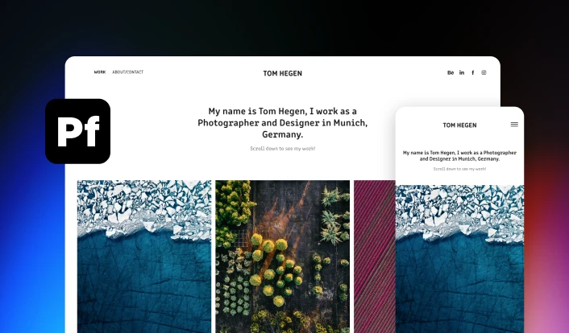

# Portfolio Site and Mobile View on Neon Gradient

**Discipline:** print-social · **Design type:** Product UI promo card
**Tags:** gradient, device, portfolio, promo, dark, responsive

## What it is
A promo graphic showing a photographer's portfolio website on desktop with a phone view overlapping its edge, a black app-icon tile at the left, on a black background with blue and magenta glows.

## What it means
Showing the same site at two sizes proves responsiveness without saying it, and the vivid photography brings color to a mostly monochrome frame. The icon tile anchors the brand.

## Techniques
- Cropped browser window running off the bottom edge to imply more content
- Overlapping a phone frame over the desktop frame to show responsive behavior
- Photography as the color payload against neutral UI and a dark surround
- Placing a bold brand tile at the left edge to sign the composition
- Blue and magenta glows in opposite corners to balance the frame

## Best for
- Announcing a portfolio or website-builder feature
- Showcasing customer work in social carousels
- Template marketplace promotions

## Vocabulary
- **Device pairing** — Showing desktop and mobile versions together in one composition.
- **Bleed crop** — Letting a screenshot run off the edge of the canvas to imply continuation.
- **Brand tile** — A square rounded app-icon shape used as a compact logo stamp.
