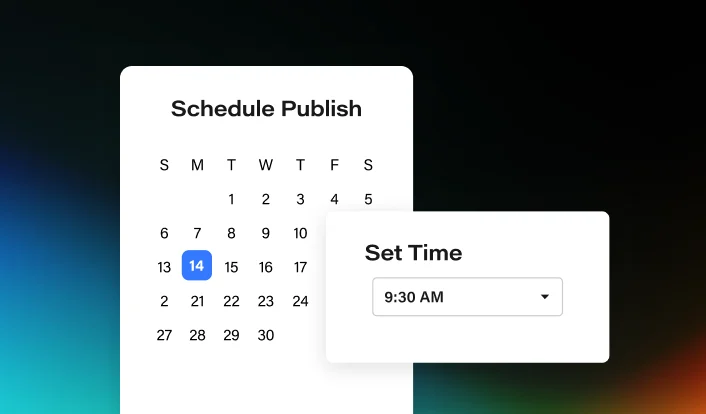

# Calendar UI Fragment on Aurora Gradient

**Discipline:** print-social · **Design type:** Product UI promo card
**Tags:** gradient, ui-fragment, dark, promo, feature-card, calendar

## What it is
A wide promo card showing two overlapping white UI panels, a date picker and a time selector, floating on a black field lit by blurred teal, blue and orange color glows at the edges.

## What it means
Isolating one feature as a crisp, oversized snippet makes a complex product feel simple and tangible. The dark glowing backdrop adds a sense of polish and modernity, and the white cards pop with maximum contrast.

## Techniques
- Crop a real interface down to one or two components and enlarge them so the feature reads in a glance
- Overlap two cards at different depths to imply a flow (choose a date, then a time)
- Bleed soft colored glows in from the corners of a near-black field instead of using a full gradient
- Use a single saturated accent (the blue selected date) as the only color inside the white UI
- Leave generous dark margin so the fragment feels like a spotlit object

## Best for
- Feature announcements and changelog posts on social
- Product marketing cards for SaaS tools
- Newsletter or blog header images that explain one capability

## Vocabulary
- **UI fragment** — A cropped, enlarged piece of an interface used as an illustration instead of a full screenshot.
- **Aurora glow** — Soft, blurred colored light bleeding in from the edges of a dark background.
- **Layered cards** — Overlapping panels at staggered positions that suggest depth and sequence.
