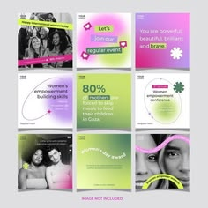

# Nine women's-day posts with purple-to-lime gradients, greyscale portraits, ribbon curves and flower stickers

**Discipline:** print-social ·  · **Design style:** Playful & Illustrated
**Tags:** womens-day, gradient, purple, lime, pink, greyscale, stickers, template-set

## What it is
A 3x3 preview of square posts using soft purple, pink and lime gradient backgrounds, greyscale photos of women with neon ribbon curves, white flower stickers, rounded pill labels for a regular event and a large 80% stat, with a note 'Image not included'.

## What it means
Uplifting and modern; gradients and mono portraits feel celebratory yet serious.

## Techniques
- Use soft neon-tinted gradients.
- Convert portraits to greyscale.
- Draw a ribbon curve across photos.
- Add flower stickers and pills.

## Best for
- Awareness and celebration campaigns
- Template packs
- Gradient social sets

## Vocabulary
- **Gradient set** — Posts sharing a soft gradient palette.
- **Ribbon curve** — A curved band crossing a photo.
- **Flower sticker** — A white flower shape as decoration.
- **Greyscale portrait** — A black-and-white photo of a person.
