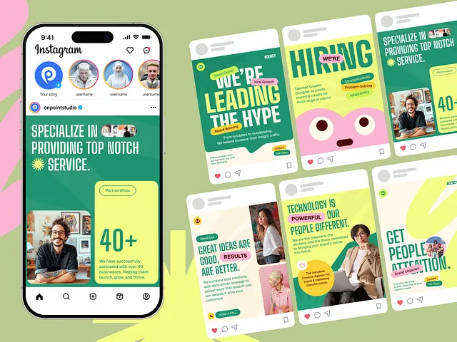

# Green agency posts with lime cards, condensed headlines and an eyeball mascot

**Discipline:** print-social ·  · **Design style:** Playful & Illustrated
**Tags:** agency, green, lime, pink, condensed-type, mascot, instagram, templates

## What it is
A pale green field with a phone showing an Instagram feed post and a grid of six posts in deep green, lime and cream. They use big condensed and rounded headlines, small pill tags, photo cutouts of smiling professionals, a big '40+' stat block and a pink blob mascot with eyes for a hiring post.

## What it means
Friendly and confident; green-lime palettes feel fresh and modern for an agency.

## Techniques
- Mix condensed headlines with rounded ones.
- Add a mascot for the hiring post.
- Use lime blocks for stats and green for photos.
- Show the set beside a phone.

## Best for
- Agency and studio social sets
- Hiring and stats posts
- Green-lime brands

## Vocabulary
- **Mascot post** — A post starring a brand character.
- **Stat block** — A block with one large number.
- **Pill tag** — A small label on a post.
- **Set overview** — An image showing a series together.
