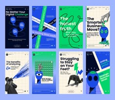

# Eight vertical business-story cards in green and blue with diagonal text bands and surreal hand-eye icons

**Discipline:** print-social ·  · **Design style:** 3D & Surreal
**Tags:** carousel, story-format, green, blue, diagonal-bands, surreal-icons, business, bold-type

## What it is
A 4x2 sheet of tall story cards alternating royal blue, mint green and cream. Bold sans questions like 'No Matter Your Digital Challenge' run in text or on tilted bands, with cut-out hands, eyes and figures in blue and green.

## What it means
Loud, quirky and modern; surreal icons add personality to business messaging.

## Techniques
- Run text on diagonal bands across a card.
- Use a limited blue, green and cream palette.
- Fill cards with surreal single-colour icons (eye in a hand).
- Alternate solid and grid-paper backgrounds.

## Best for
- Business and tech story posts
- Agency social sets
- Bold educational carousels

## Vocabulary
- **Diagonal band** — A tilted strip carrying text.
- **Surreal icon** — A dreamlike pictogram such as an eye in a hand.
- **Story card** — A 9:16 vertical social layout.
- **Grid-paper card** — A card with a squared notebook background.
