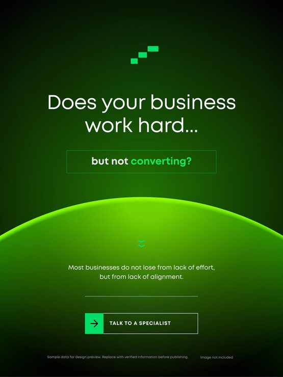

# Dark green 'Does your business work hard... but not converting?' post with a lime glowing horizon

**Discipline:** print-social · **Design type:** Social promo post · **Design style:** Dark & Neon
**Tags:** business, conversion, green, glow, horizon, cta, consulting

## What it is
A portrait post in deep green with a pixel-step logo, a two-part question headline ('Does your business work hard...' then 'but not converting?' in an outlined box), a bright lime glowing planet arc across the middle, a small chevron, a supporting line and a 'Talk to a specialist' button with an arrow tile.

## What it means
Suspenseful and direct; the rising glow feels like a turning point, selling a solution after naming the pain.

## Techniques
- Split the headline into setup and outlined punchline.
- Use a glowing horizon arc to divide problem and answer.
- Pair a solid arrow tile with an outlined button.
- Keep one saturated hue on near-black.

## Best for
- Consulting and agency ads
- Conversion and CRO services
- Problem–solution hooks

## Vocabulary
- **Problem–solution** — A layout naming a pain then offering a fix.
- **Outlined box** — A thin stroke frame around text for emphasis.
