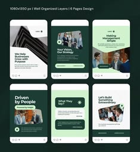

# Six deep-green corporate posts with photo panels, mint cards and lime tags

**Discipline:** print-social · **Design type:** Social template pack
**Tags:** corporate, green, mint, lime, templates, photo-panels, carousel, business

## What it is
A 1080x1350 template preview of six portrait posts in forest green, mint and cream mixing bold white or green headlines, team photos in rounded panels, checklist cards and lime label pills.

## What it means
Trustworthy and growth-oriented; green feels sustainable and financial.

## Techniques
- Combine dark green with mint and lime accents.
- Use rounded photo panels.
- Place text in white cards on photos.
- Keep layouts modular.

## Best for
- Corporate and consulting carousels
- Editable template packs
- Sustainability-minded brands

## Vocabulary
- **Template preview** — An overview of layouts in a pack.
- **Mint card** — A pale green content card.
- **Lime tag** — A bright small label.
- **Photo panel** — A rounded photo container.
