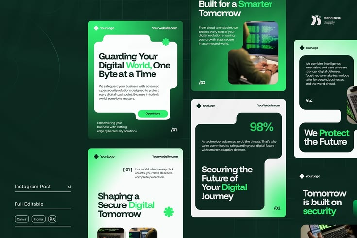

# Green Cybersecurity Post Templates with Notched Cards

**Discipline:** print-social ·  · **Design style:** Dark & Neon
**Tags:** templates, cybersecurity, green, dark, notched-card, gradient, instagram

## What it is
A dark green board showing an Instagram post template set for cybersecurity: green gradient posts with white or dark notched cards holding bold headlines with green emphasis words, small copy, a 98% stat, photos of hands on keyboards and a clover-like star icon, with format and tool labels at the left.

## What it means
Green gradients and notched cards feel technical and fresh, and one emphasis word per headline keeps a clear voice.

## Techniques
- Notched card shapes with a rounded cut-out corner
- Green emphasis word in each headline
- Alternating dark and light cards on green gradients
- Slide numbers like /01 in the corners
- Format and tool labels beside the set

## Best for
- Cybersecurity and tech social templates
- Template marketplace previews
- Green gradient brand systems

## Vocabulary
- **Notched card** — A card with a cut-out corner to hold another element.
- **Emphasis word** — One word coloured to stand out in a headline.
- **Template label** — Text listing formats and tools a template supports.
