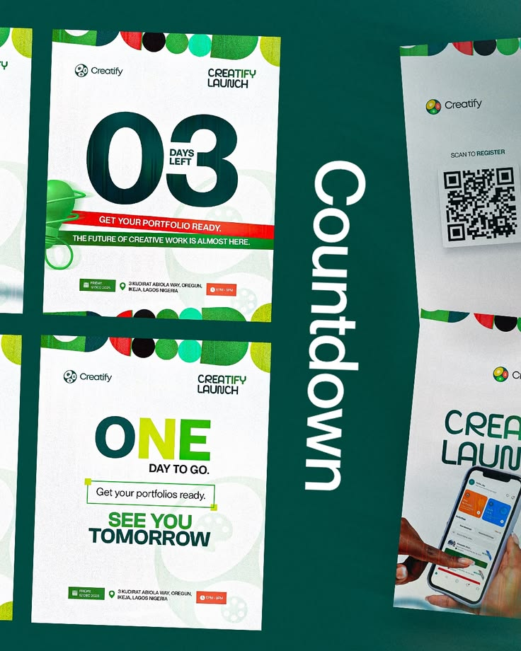

# Green Event Countdown Poster Series

**Discipline:** print-social · **Design type:** Social ad set
**Tags:** countdown, event, green, white, poster, qr, series

## What it is
A deep green board with white event posters: '03 days left' with a giant numeral and red and green ribbon, 'ONE day to go', and cropped QR and phone posters, with a vertical 'Countdown' label.

## What it means
Big numerals make the countdown instantly readable, and the shared header pattern ties the series together.

## Techniques
- Giant numerals as the focal graphic
- Coloured header strip of shapes on every poster
- Vertical label naming the series
- Details row with date, place and time chips
- Angled crops of neighbouring posters

## Best for
- Event countdown campaigns
- Launch series
- Social poster sets

## Vocabulary
- **Countdown numeral** — An oversized number showing days remaining.
- **Header strip** — A repeated band of shapes along the top of posters.
- **Details chips** — Small labels for date, place and time.
