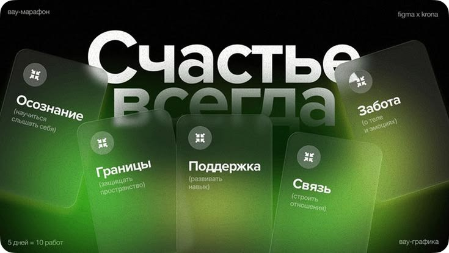

# Green Glass Cards Marathon Cover

**Discipline:** print-social ·  · **Design style:** Glassmorphism
**Tags:** glass, green, cyrillic, cards, dark, marathon, cover

## What it is
A black cover with a giant white Cyrillic headline behind five tilted frosted glass cards on a glowing green blur, each card holding an icon, a keyword and a small note, plus small corner labels.

## What it means
Frosted cards over green light feel like a modern, mindful workshop, and the huge headline gives the cover authority.

## Techniques
- Frosted glass cards at different tilts
- Green glow blur beneath the glass
- Giant headline partly hidden by cards
- Icon plus keyword plus note on each card
- Corner labels for series and format

## Best for
- Workshop and marathon covers
- Course announcements
- Glassmorphism posters

## Vocabulary
- **Glass card** — A blurred translucent card over a colourful backdrop.
- **Glow blur** — A coloured light blur behind translucent objects.
- **Corner labels** — Small captions in the frame corners.
