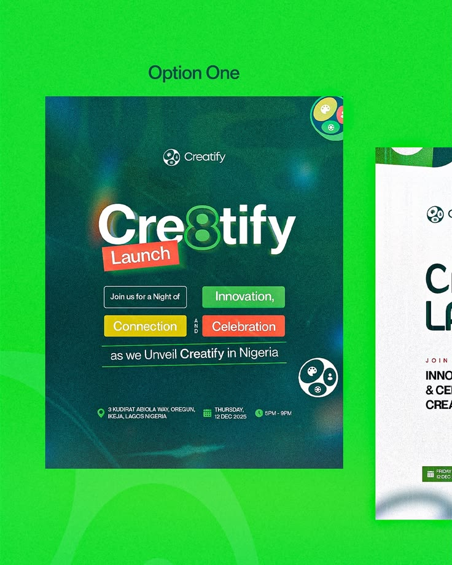

# Launch Flyer Option One with Label Chips

**Discipline:** print-social ·  · **Design style:** Retro & Pixel
**Tags:** launch, green, label-chips, grain, bokeh, option, nigeria

## What it is
A presentation of a launch flyer on neon green: a dark teal flyer with grain and bokeh, a heavy 'Creatify' wordmark with an 8 as the letter, a red Launch tag, coloured label chips (Innovation, Connection, Celebration) and event details, with a second option peeking in at the right.

## What it means
Colourful label chips make a list playful and readable, and the number-as-letter adds personality.

## Techniques
- Number 8 replacing a letter in the wordmark
- Coloured label chips highlighting key words
- Grainy dark teal with soft bokeh lights
- Details row with icons for place, date and time
- Option presentation on a bright contrasting green

## Best for
- Event launch flyers
- Option comparisons for clients
- Bold local event branding

## Vocabulary
- **Label chip** — A coloured rectangle behind a word for emphasis.
- **Bokeh** — Soft out-of-focus light spots.
- **Design option** — One of several alternative layouts presented to a client.
