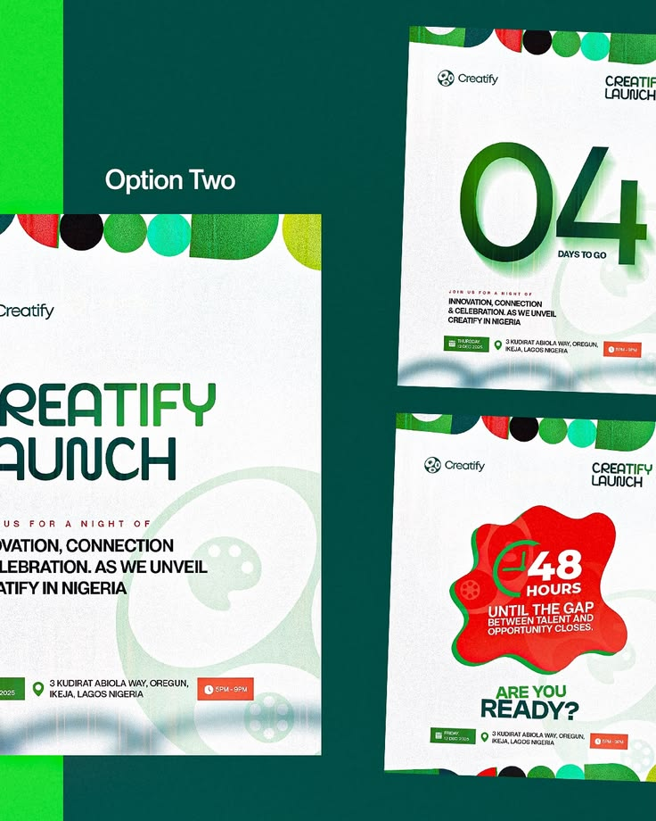

# Launch Flyer Option Two with Countdown

**Discipline:** print-social · **Design type:** Event flyer
**Tags:** launch, green, countdown, red-blob, geometric-circles, options, nigeria

## What it is
A dark green presentation of three white flyer options with a row of colourful circles and semicircles along the top: the large Creatify Launch flyer with a green wordmark, a 04 days countdown flyer with a huge green numeral, and a 48 hours flyer with a red blob badge and the question 'Are you ready?', each with details bars in green and red.

## What it means
A row of geometric circles gives a joyful, African-pattern feel, and the huge countdown numbers add urgency.

## Techniques
- Row of coloured circles and semicircles as a header
- Giant green numerals for the countdown
- Red blob badge with a clock icon
- Green and red detail bars for place and time
- Options shown on a dark green ground

## Best for
- Launch and countdown flyers
- Event teaser series
- Presenting flyer options to clients

## Vocabulary
- **Countdown series** — Posts counting down days or hours to an event.
- **Pattern header** — A band of repeating shapes along an edge.
- **Blob badge** — An organic shape holding a key message.
