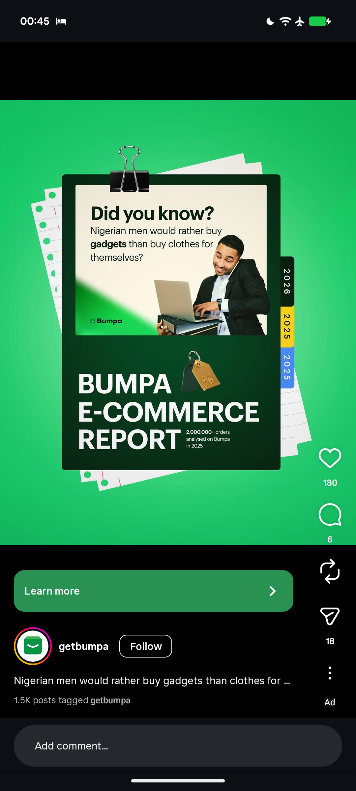

# Did You Know E-Commerce Report Ad on Green Paper Stack

**Discipline:** print-social ·  · **Design style:** Warm & Organic
**Tags:** ad, green, binder-clip, paper-stack, report, cream-card, stat, vertical-year-tabs

## What it is
A vivid green radial background with a stack of ruled paper sheets and a dark green clipboard held by a black binder clip, showing a cream card 'Did you know? Nigerian men would rather buy gadgets than clothes for themselves?' with a smiling man on a laptop and phone, a big white 'BUMPA E-COMMERCE REPORT' with a gold price-tag icon, a small stat, and vertical 2026 and 2025 tabs on the right edge.

## What it means
Turning a data report into a physical folder makes a stat feel like a document you can pick up, and green is the brand throughout.

## Techniques
- Report shown as a clipped folder on paper
- Vertical index tabs for years
- 3D gold tag icon beside the title
- Cream inner card over dark green
- Radial green glow behind the object

## Best for
- Report and study teasers
- E-commerce and fintech ads
- Object metaphors for documents

## Vocabulary
- **Clipboard mockup** — A document shown on a clipboard with a binder clip.
- **Index tab** — A tab on the edge of a page labelling a section.
- **Teaser stat** — A surprising fact used to invite a click.
