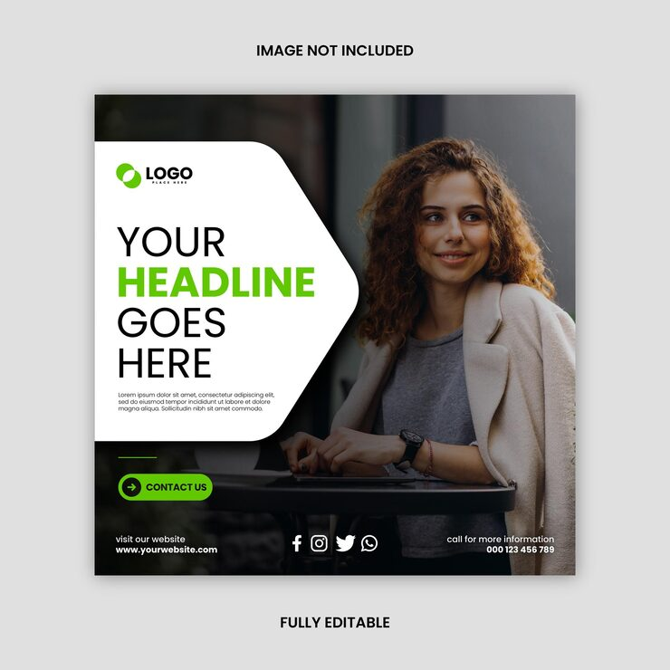

# Lime-accented post with an arrow-shaped white panel over a café portrait

**Discipline:** print-social · **Design type:** Social ad · **Design style:** Corporate & Clean-Tech
**Tags:** corporate, lime, arrow, portrait, ad, template

## What it is
A square post with a darkened photo of a curly-haired woman smiling at a café table, a white panel with a pointed arrow edge holding a logo and 'YOUR HEADLINE GOES HERE' with 'HEADLINE' in lime, a lime 'Contact us' pill with arrow, and a footer row with website, social icons and phone.

## What it means
Clean and directive; the arrow panel points from message to person.

## Techniques
- Shape the text panel as an arrow pointing at the subject.
- Darken the photo for a moody base.
- Colour one headline word lime.

## Best for
- Corporate ads
- Consulting services
- Template-driven campaigns

## Vocabulary
- **Arrow panel** — A text box with a pointed edge.
- **Footer row** — A bottom strip of contacts.
