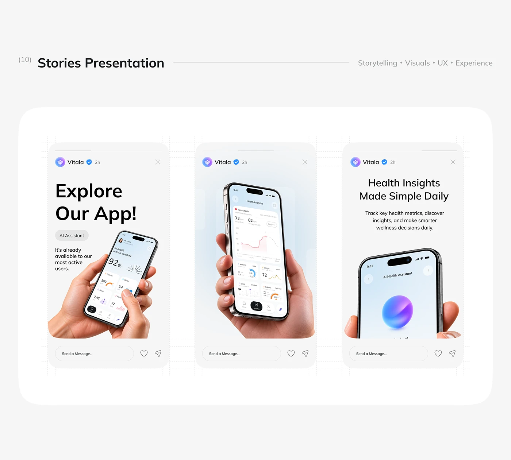

# Health App Stories Presentation

**Discipline:** print-social · **Design type:** Story set
**Tags:** stories, health, grey, hands, phone, orb, presentation

## What it is
A grey board titled Stories Presentation with a rounded white panel holding three story frames: bold headline with a hand-held phone, a phone showing analytics, and a headline with an AI orb phone.

## What it means
Stories with big hands and screens make the product feel tangible, and consistent chrome links the trio.

## Techniques
- Three frames with identical header and reply bar
- Hands holding phones at different angles
- Bold headline on first, quiet ones on others
- Blue-to-violet orb as the AI symbol
- Dashed grid lines behind the frames

## Best for
- Story ad concepts
- App promotion sets
- Presentations of social work

## Vocabulary
- **Story frame** — A vertical panel with story-style header and reply bar.
- **AI orb** — A glossy gradient sphere used as an AI symbol.
- **Presentation panel** — A rounded container holding a set of designs.
