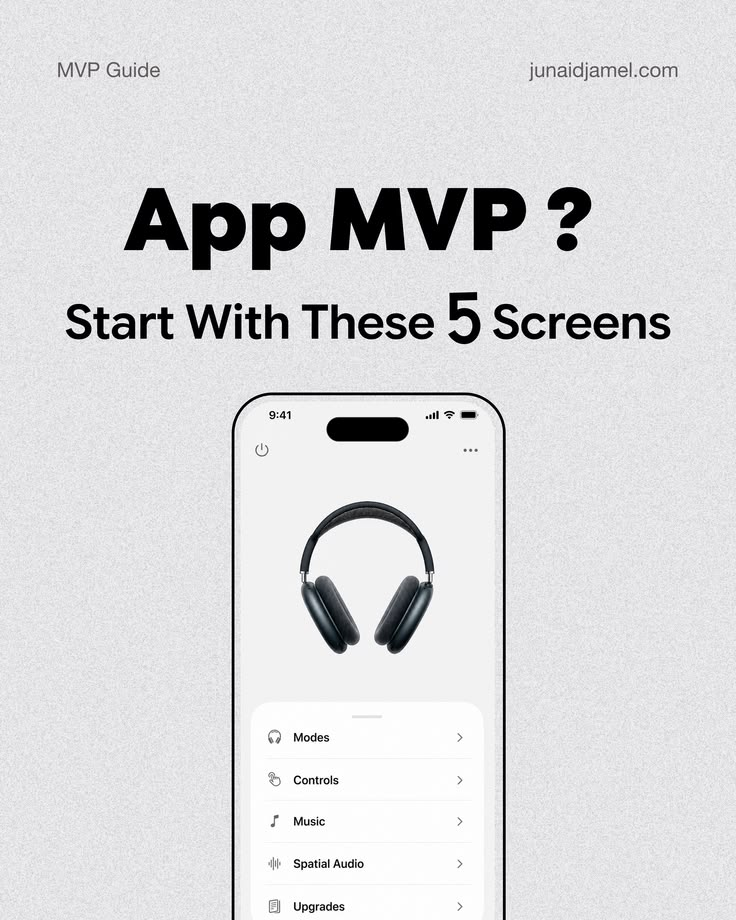

# App MVP Five Screens Cover

**Discipline:** print-social · **Design type:** Social cover post
**Tags:** cover, mvp, grey, bold-type, phone, headphones, carousel

## What it is
A grainy grey carousel cover with a heavy 'App MVP ?' headline, a subhead 'Start with these 5 screens' with a large 5, and a phone showing a headphone product menu cropped at the bottom.

## What it means
Big black type and a cropped phone are a clear hook, and the question invites a swipe.

## Techniques
- Huge heavy headline with a question mark
- Enlarged number inside the subtitle
- Phone cropped at the base to imply more
- Grain texture on a flat grey
- Small series header and site link

## Best for
- Carousel covers
- Educational hooks
- Product-design creators

## Vocabulary
- **Hook cover** — A first slide designed to stop the scroll.
- **Number emphasis** — Making a figure larger than the words around it.
- **Bleed crop** — Letting an object run off the edge of the frame.
