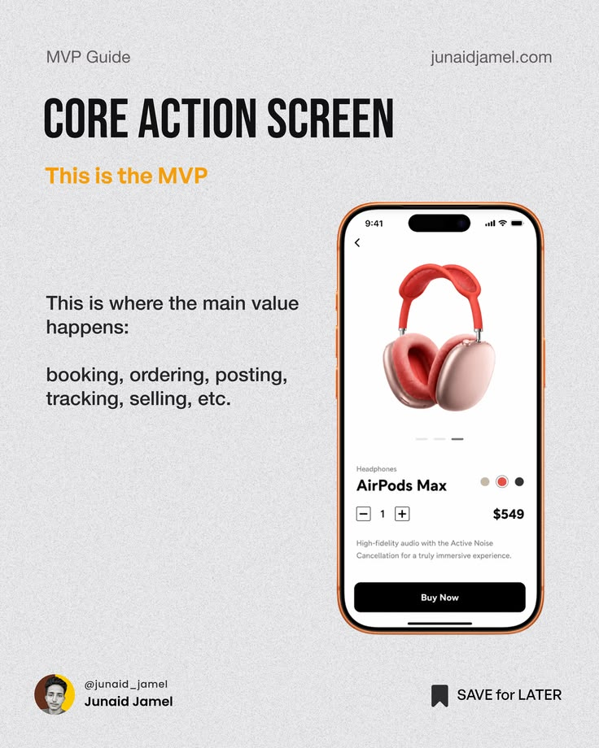

# MVP Guide Core Action Screen Post

**Discipline:** print-social ·  · **Design style:** Retro & Pixel
**Tags:** educational, mvp, grey, condensed, phone, orange, product-design

## What it is
A grainy light-grey post with a tall condensed black headline, an orange subtitle, short explanatory copy, and a phone with an orange bezel showing a headphone product screen.

## What it means
Paper-like grain and orange accents feel friendly and practical. The phone shows the concept rather than just describing it.

## Techniques
- Condensed heavy headline against light body copy
- Orange accent tying the subtitle to the phone bezel
- Grain texture over flat grey
- Example screen as an illustration of the lesson
- Author avatar and Save for later prompt in the footer

## Best for
- Product-design education
- Carousel lessons
- Creator content

## Vocabulary
- **Grain texture** — Fine noise overlay that gives a flat colour a paper feel.
- **Save prompt** — A footer element encouraging bookmarking.
- **Accent bezel** — A phone frame coloured to match the accent.
