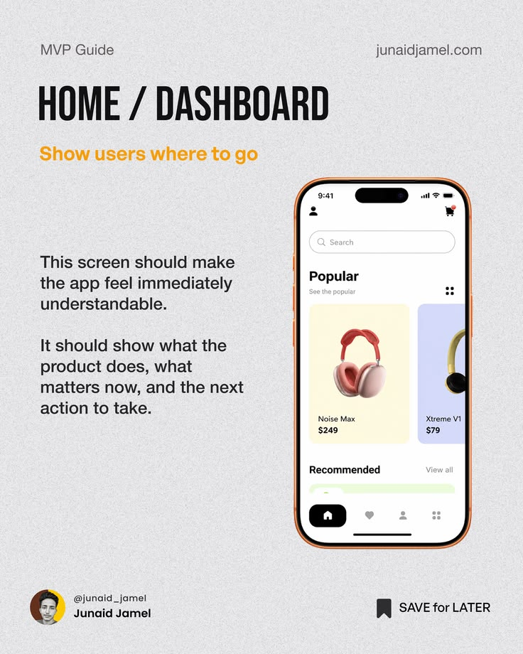

# MVP Guide Home Dashboard Post

**Discipline:** print-social ·  · **Design style:** Corporate & Clean-Tech
**Tags:** educational, mvp, grey, condensed, phone, orange, dashboard

## What it is
A grainy grey post in a series with a tall condensed 'HOME / DASHBOARD' heading, orange subhead, explanatory copy and an orange-bezel phone showing a product home screen.

## What it means
The repeated layout makes a series easy to follow and the phone illustrates the advice instantly.

## Techniques
- Series template: same header, subhead and phone placement each slide
- Condensed heavy caps for the title
- Orange subhead and bezel as unifying accent
- Left text and right device balance
- Footer creator card and save prompt

## Best for
- Multi-slide educational series
- Product design creators
- LinkedIn and Instagram carousels

## Vocabulary
- **Series template** — A repeatable layout used across slides.
- **Subhead accent** — A coloured line under the title summarising the point.
- **Creator footer** — A bar with the author's avatar, handle and save prompt.
