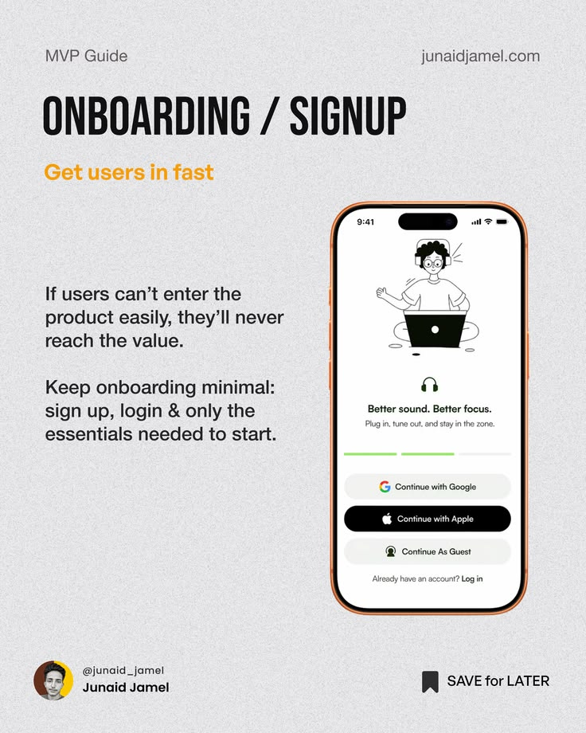

# MVP Guide Onboarding Signup Post

**Discipline:** print-social ·  · **Design style:** Minimalist
**Tags:** educational, mvp, grey, condensed, phone, orange, onboarding

## What it is
A grainy grey post in the MVP series with a tall condensed 'ONBOARDING / SIGNUP' heading, an orange subhead 'Get users in fast', advice text and an orange-bezel phone showing a minimal sign-up screen with an illustration and continue buttons.

## What it means
The repeated layout is easy to follow and the real screen makes the advice concrete.

## Techniques
- Series template with a fixed heading and phone
- Condensed heavy caps title
- Orange bezel and subhead as accent
- Two short advice paragraphs
- Creator footer with a save prompt

## Best for
- Product design carousels
- Onboarding advice
- Creator content series

## Vocabulary
- **Series template** — A repeatable layout across slides.
- **Subhead accent** — A coloured line summarising the slide.
- **Accent bezel** — A phone frame coloured to match the accent.
