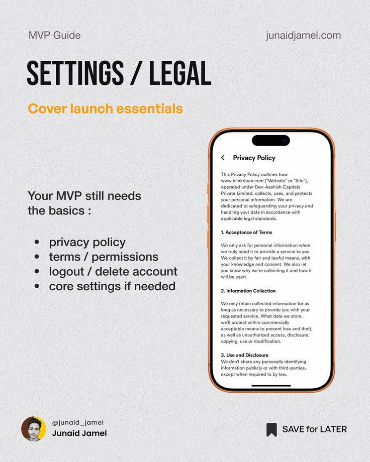

# MVP Guide Settings and Legal Post

**Discipline:** print-social · **Design type:** Social educational post
**Tags:** educational, mvp, grey, condensed, phone, orange, legal

## What it is
A grainy grey post in the MVP series with a tall condensed 'SETTINGS / LEGAL' heading, orange subhead, a bullet list of launch basics and an orange-bezel phone showing a privacy policy page.

## What it means
The repeated series layout makes advice easy to follow, and a real screen grounds the tip.

## Techniques
- Series template with fixed heading, subhead and phone position
- Condensed heavy caps title
- Orange bezel and subhead as accent
- Bullet list in plain sans beside the device
- Creator footer with save prompt

## Best for
- Product design education series
- Creator carousels
- Checklist-style posts

## Vocabulary
- **Series template** — A repeatable layout used across slides.
- **Checklist post** — A post listing must-have items as bullets.
- **Save prompt** — A footer element encouraging bookmarking.
