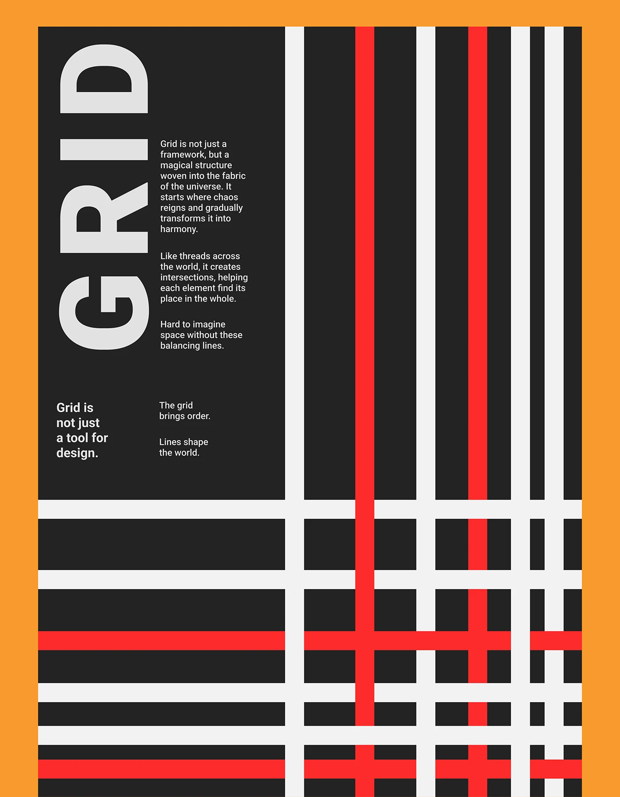

# Rotated 'GRID' word beside a lattice of white and red lines on black with orange border

**Discipline:** print-social ·  · **Design style:** Dark & Neon
**Tags:** poster, grid, black, white, red, orange, rotated-type, lines

## What it is
A poster with an orange frame, a black field with a huge grey rotated 'GRID' at the top left with small paragraphs beside it, and below and to the right thick white and red horizontal and vertical lines forming a woven lattice.

## What it means
Structured and lively; the lines show the idea of a grid literally.

## Techniques
- Illustrate the word with a lattice.
- Use red lines as highlights.
- Rotate the word 90 degrees.
- Frame with orange.

## Best for
- Concept typographic posters
- Swiss and modernist series
- Line-based graphics

## Vocabulary
- **Lattice** — Crossing lines forming a grid.
- **Red accent line** — A single red line among white ones.
- **Rotated word** — A word set vertically.
- **Frame colour** — A coloured border around a poster.
