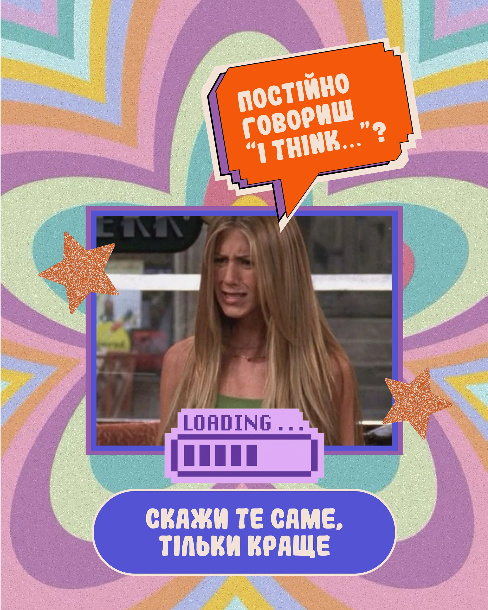

# Retro flower-pattern post with an orange pixel speech bubble, a TV-still photo, loading bar and pill caption

**Discipline:** print-social · **Design type:** Social educational post
**Tags:** language, retro, groovy, orange, pixel-speech-bubble, loading-bar, glitter-stars, cyrillic

## What it is
A grainy pastel groovy flower-pattern backdrop in lilac, teal, mint and pink with an orange pixel-edged speech bubble with cream cartoon caps, a purple-framed still of a woman making a doubtful face, a pixel 'LOADING' bar at 40%, two glitter orange stars and a blue pill caption 'СКАЖИ ТЕ САМЕ, ТІЛЬКИ КРАЩЕ'.

## What it means
Playful and meme-like; the loading bar jokes about upgrading a phrase.

## Techniques
- Use a groovy 70s flower pattern.
- Add a pixel speech bubble.
- Include a loading bar as a joke.
- Add glitter stars and a pill caption.

## Best for
- Language tips and memes
- Retro-pop posts
- Educational humour

## Vocabulary
- **Pixel speech bubble** — A speech bubble with stepped edges.
- **Loading bar** — A progress bar graphic used as a joke.
- **Groovy pattern** — A 70s-style concentric petal pattern.
- **Glitter star** — A star with glitter texture.
