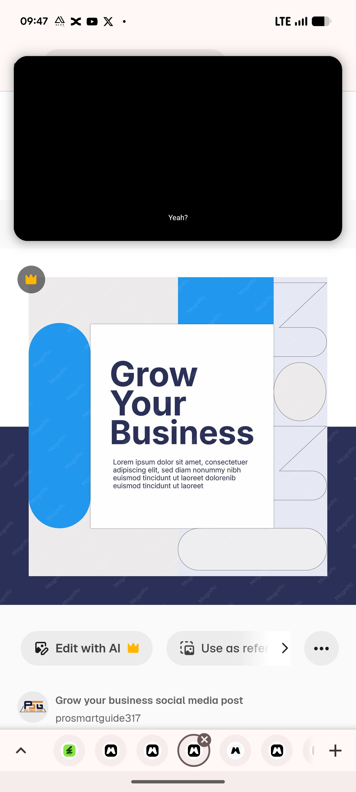

# Grow Your Business Template Full View

**Discipline:** print-social · **Design type:** Social template pack
**Tags:** business, azure, navy, pill, full-view, square, template, white-card

## What it is
The full square template on a white and navy split background: an azure block, a tall azure pill at the left, a white card with a heavy navy 'Grow Your Business' headline and paragraph, and a column of outlined half-shapes and a circle at the right, with a wide empty pill at the base.

## What it means
The whole layout shows how a few basic shapes and one card make a confident business post.

## Techniques
- White card floating over colour blocks
- Empty outlined pill as a decorative or text placeholder
- Navy band under the lower half of the canvas
- Fine-line arcs in a right column
- Heavy sans headline left-aligned

## Best for
- Corporate social templates
- Geometric design references
- Blue and white promos

## Vocabulary
- **Placeholder shape** — An empty shape kept for later content.
- **Split ground** — A background divided into two colour zones.
- **Card overlay** — A card layered on top of a busy background.
