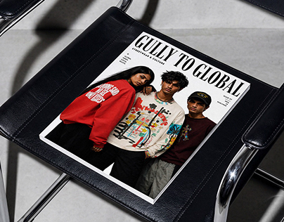

# 'Gully to Global' streetwear culture magazine cover lying on a black leather chair

**Discipline:** print-social · **Design type:** Magazine cover · **Design style:** Editorial
**Tags:** magazine, streetwear, editorial, serif, mockup, youth

## What it is
A magazine mockup on a black leather and chrome chair: the cover shows three young Indian models in graphic streetwear on white, a condensed black serif masthead 'GULLY TO GLOBAL', 'Streetwear & Culture' and small cover lines.

## What it means
Confident and cultural; a classic serif masthead elevates street style to high fashion.

## Techniques
- Pair a formal serif masthead with streetwear photography.
- Shoot the magazine on a textured prop for context.
- Keep cover lines small and sparse.

## Best for
- Fashion magazines
- Streetwear brands
- Editorial mockups

## Vocabulary
- **Masthead** — The title of a magazine on its cover.
- **Cover lines** — Short text teasers on a magazine cover.
