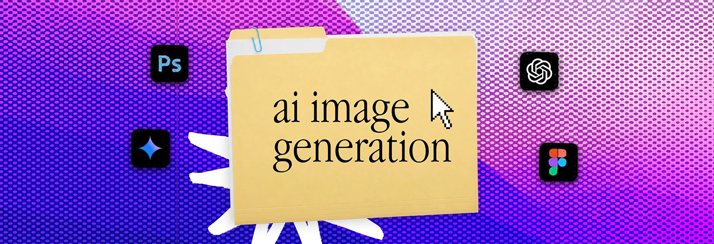

# Violet and magenta halftone banner with an 'ai image generation' folder and app icons

**Discipline:** print-social · **Design type:** Social banner
**Tags:** banner, halftone, folder, violet, magenta, serif-label, ai, desktop-metaphor

## What it is
A wide halftone banner of blue-violet and pink dots, a manila folder titled 'ai image generation' in serif, a white scribble burst, a pixel cursor and Photoshop, Gemini, ChatGPT and Figma icons.

## What it means
Colourful and current; AI tool icons tie the folder to a topic.

## Techniques
- Change halftone colours per category.
- Use tool icons relevant to each topic.
- Keep the folder and cursor fixed.
- Add a white scribble burst.

## Best for
- Category banners
- AI and design freelancer profiles
- Series headers

## Vocabulary
- **Topic icons** — App logos chosen to match the subject.
- **Halftone duotone** — Dots in two colours.
- **Fixed folder** — A constant central element across a series.
- **Scribble burst** — A rough hand-drawn star.
