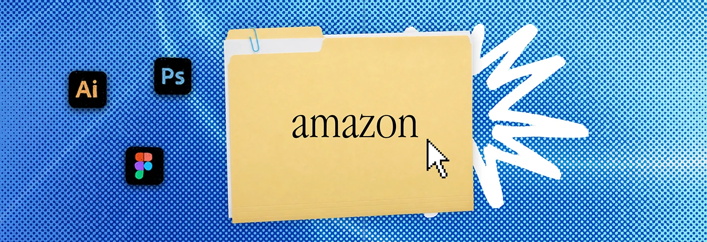

# Blue halftone banner with an 'amazon' folder and large white scribble burst

**Discipline:** print-social ·  · **Design style:** Retro & Pixel
**Tags:** banner, halftone, folder, blue, scribble, serif-label, icons, desktop-metaphor

## What it is
A blue halftone banner with a manila folder titled 'amazon', a big white scribble star at its right, a pixel cursor and Illustrator, Photoshop and Figma icons.

## What it means
Recognisable and playful; consistent folder motif keeps the series unified.

## Techniques
- Keep the folder identical across variants.
- Change only the background hue and label.
- Use a bold white scribble as energy.
- Show only relevant tool icons.

## Best for
- Platform-specific portfolio banners
- Series headers
- Freelancer profiles

## Vocabulary
- **Series constant** — An element that stays the same across variants.
- **White scribble** — A rough white starburst.
- **Platform label** — A brand name on a folder tab.
- **Halftone blue** — Blue dot texture.
