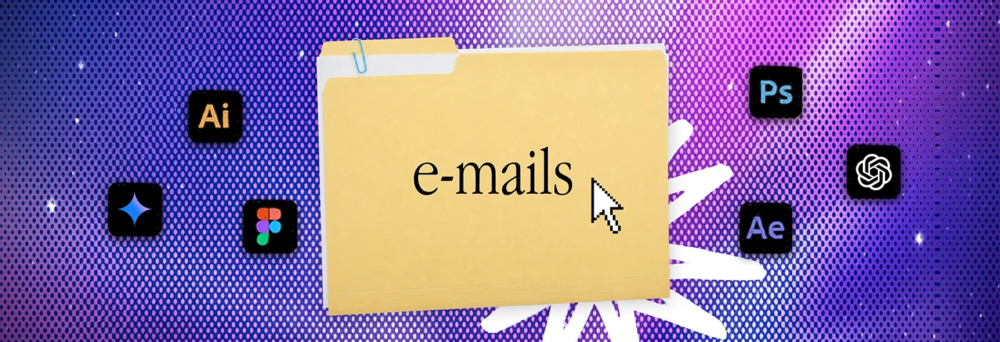

# Purple and magenta halftone banner with an 'e-mails' folder, starry sky and six tool icons

**Discipline:** print-social ·  · **Design style:** Retro & Pixel
**Tags:** banner, halftone, folder, purple, magenta, stars, serif-label, icons

## What it is
A wide banner in a violet-to-magenta halftone dot field with tiny stars, a manila folder with a paper clip and 'e-mails', a pixel cursor, a white scribble burst and Ai, Photoshop, Figma, After Effects, spark and ChatGPT icons.

## What it means
Vivid and cosmic; the starry halftone gives the desktop metaphor depth.

## Techniques
- Add stars to the halftone field.
- Keep the folder in the centre.
- Surround it with relevant tools.
- Add a white scribble burst.

## Best for
- Series banners
- Email design freelancers
- Purple palettes

## Vocabulary
- **Starry halftone** — A dot field with small stars.
- **Tool icon set** — App icons for the tools used.
- **Folder title** — A label on a folder.
- **Scribble burst** — A rough hand-drawn star.
