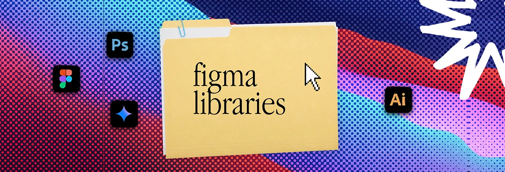

# Red, violet and cyan halftone wave banner with a paper-clipped 'figma libraries' folder

**Discipline:** print-social · **Design type:** Social banner
**Tags:** banner, halftone, folder, wave, red, violet, cyan, serif-label

## What it is
A wide banner with coarse halftone dots in red, violet, blue and cyan forming layered waves, a manila folder with a paper clip and 'figma libraries' in serif, a pixel cursor, four dark app icons and a white scribble burst at the corner.

## What it means
Vivid and nostalgic; wave-like halftone gives the desktop metaphor motion.

## Techniques
- Form waves from halftone colour bands.
- Clip a paper to the folder.
- Use dark rounded app icons.
- Keep folder and cursor central.

## Best for
- Creator resource banners
- Series headers
- Design tool content

## Vocabulary
- **Halftone wave** — Layered wavy shapes rendered in dots.
- **Paper clip** — A clip graphic attached to a folder.
- **Dark app icon** — A black rounded square with a tool logo.
- **Folder title serif** — A serif label on a folder.
