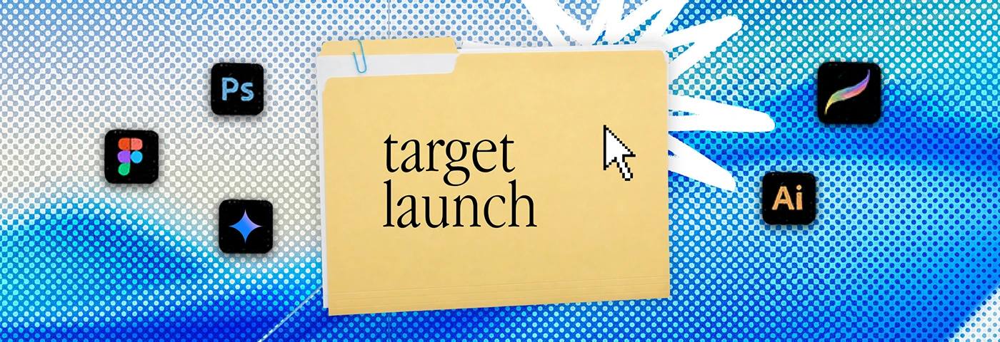

# Blue halftone banner with a 'target launch' folder and white scribble

**Discipline:** print-social ·  · **Design style:** Retro & Pixel
**Tags:** banner, halftone, folder, blue, desktop-metaphor, serif-label, icons

## What it is
A wide banner with blue and grey halftone dots. A manila folder labelled 'target launch' in serif sits in the middle with a cursor, a white brush burst behind, and app icons (Photoshop, Figma, Illustrator, Procreate, a spark) around.

## What it means
Nostalgic desktop and creator-tool energy; the halftone gives a print-like warmth to digital icons.

## Techniques
- Put the category name on a folder tab so a banner works as a label.
- Apply coarse halftone in a blue palette over an abstract gradient.
- Add a white gestural scribble behind the folder.
- Surround with tool icons to signal skills.

## Best for
- Service-menu banners
- Creative freelancer profiles
- Slide dividers

## Vocabulary
- **Halftone** — An image or gradient made of a dot grid.
- **Folder label** — A serif title on a manila folder graphic.
- **Tool icon ring** — App logos arranged around a central object.
- **Brush burst** — A rough painted starburst.
