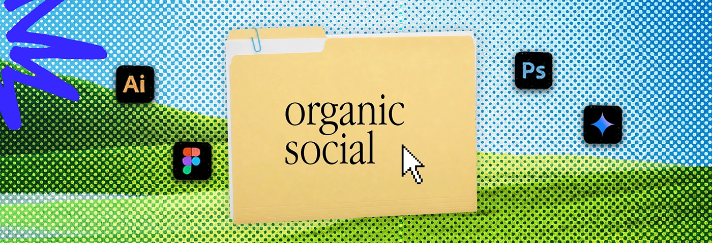

# Green hill halftone banner with an 'organic social' folder

**Discipline:** print-social ·  · **Design style:** Retro & Pixel
**Tags:** banner, halftone, folder, green, blue, landscape, desktop-metaphor

## What it is
A wide banner where a halftone photo of green hills under a blue sky forms the backdrop, with a manila folder labelled 'organic social', a blue scribble at the left and tool icons around a cursor.

## What it means
Fresh and light; the pastoral halftone hints at 'organic' while the folder keeps it digital.

## Techniques
- Choose a halftone background that matches the folder's subject (hills for organic).
- Contrast the warm yellow folder with cool green and blue.
- Overlap the blue brush stroke at the frame edge for energy.
- Keep the folder centered so labels swap easily across a series.

## Best for
- Series of category banners
- Creator and agency service pages
- Content pillar headers

## Vocabulary
- **Series template** — A layout reused with only the label changed.
- **Halftone landscape** — A landscape photo converted to dots.
- **Warm-cool contrast** — A warm object on a cool background.
- **Pillar banner** — A header for one content category.
