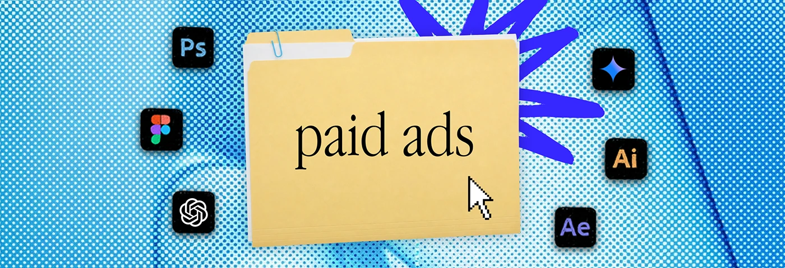

# Cyan halftone banner with a 'paid ads' folder and violet scribble

**Discipline:** print-social ·  · **Design style:** Retro & Pixel
**Tags:** banner, halftone, folder, cyan, violet-scribble, serif-label, icons, desktop-metaphor

## What it is
A wide cyan and white halftone banner with a manila folder labelled 'paid ads', a bright blue scribble burst behind it, a pixel cursor and six app icons.

## What it means
Crisp and digital; single-hue halftone feels like a blueprint.

## Techniques
- Limit halftone to a single blue family.
- Use a violet scribble as the accent.
- Keep composition identical to other banners.
- Surround the folder with app icons.

## Best for
- Service menu banners
- Marketing freelancers
- Profile headers

## Vocabulary
- **Monochrome halftone** — A dot texture in one hue.
- **Scribble accent** — A rough burst behind an object.
- **Tool icon ring** — App icons around a central item.
- **Folder label** — A service name on a folder.
