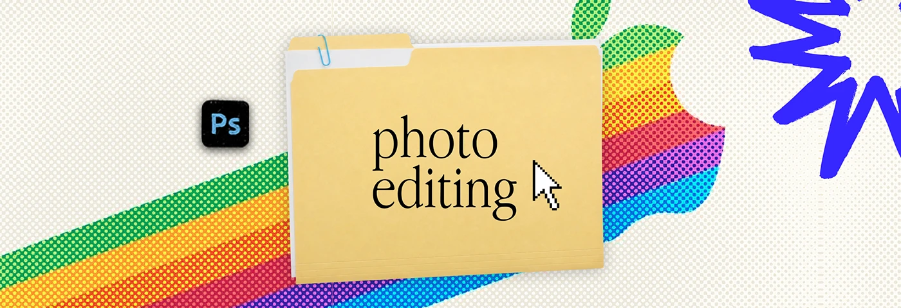

# Cream halftone banner with a rainbow stripe swoosh, 'photo editing' folder and blue scribble

**Discipline:** print-social · **Design type:** Social banner
**Tags:** banner, halftone, folder, rainbow, cream, blue-scribble, retro, serif-label

## What it is
A cream dotted banner with a halftone rainbow stripe sweeping diagonally and forming a fruit-logo silhouette at right, a manila folder with a paper clip and 'photo editing', a Photoshop icon, a pixel cursor and a blue scribble burst.

## What it means
Retro and cheerful; the rainbow nods to early computing.

## Techniques
- Use a halftone rainbow stripe as the backdrop.
- Keep folder and cursor central.
- Add a single tool icon.
- Use a blue scribble at the edge.

## Best for
- Series headers
- Creator profile banners
- Retro-computing themes

## Vocabulary
- **Rainbow stripe** — A band of spectrum colours.
- **Retro computing** — Visual references to early personal computers.
- **Tool icon** — An app logo on a rounded square.
- **Scribble burst** — A rough hand-drawn star.
