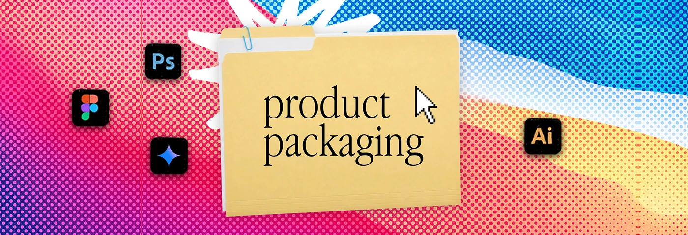

# Pink-to-blue halftone banner with a 'product packaging' folder and tool icons

**Discipline:** print-social · **Design type:** Social banner
**Tags:** banner, halftone, folder, pink, blue, gradient, desktop-metaphor, serif-label

## What it is
A wide banner with a red-pink to violet to blue halftone gradient, a manila folder titled 'product packaging' in serif, a pixel cursor, a white scribble burst and Photoshop, Figma, spark and Illustrator icons.

## What it means
Colourful and nostalgic; the vivid halftone makes a simple label feel like a poster.

## Techniques
- Use a multi-colour gradient under halftone dots.
- Keep the folder composition constant across a series.
- Add a white scribble burst behind the folder.
- Surround with app icons for skill hints.

## Best for
- Service-category banners
- Creative portfolio headers
- Series with swappable labels

## Vocabulary
- **Halftone gradient** — A gradient rendered as dots.
- **Folder title** — A category name on a folder.
- **Scribble burst** — A rough hand-drawn star.
- **Series template** — A layout reused with a changed label.
