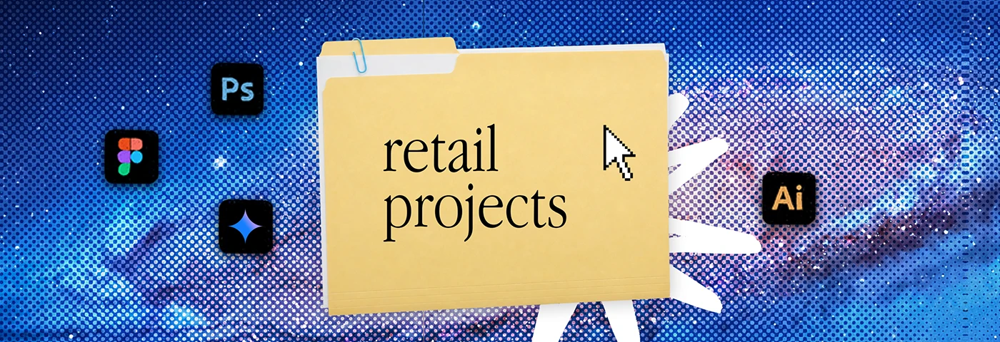

# Galaxy halftone banner with a 'retail projects' folder

**Discipline:** print-social · **Design type:** Social banner
**Tags:** banner, halftone, folder, galaxy, blue, desktop-metaphor, series

## What it is
A wide banner with a blue-purple galaxy image treated in coarse halftone dots. A manila folder labelled 'retail projects' sits at centre, with a cursor, a white scribble, and Photoshop, Figma, Illustrator and spark icons.

## What it means
Deep and cosmic yet nostalgic; halftone gives space imagery a print feel.

## Techniques
- Convert a dramatic photo to halftone so it becomes texture.
- Keep the folder in the same position across a series.
- Use a white scribble burst for contrast against a dark background.
- Include tool icons as skill hints.

## Best for
- Portfolio and service-category banners
- Creator profile headers
- Divider images in decks

## Vocabulary
- **Halftone image** — A photograph rendered as a dot pattern.
- **Series consistency** — Reusing one composition with changed content.
- **Cursor graphic** — A pixel arrow used as a decorative pointer.
- **Galaxy texture** — Star-field imagery as a background.
